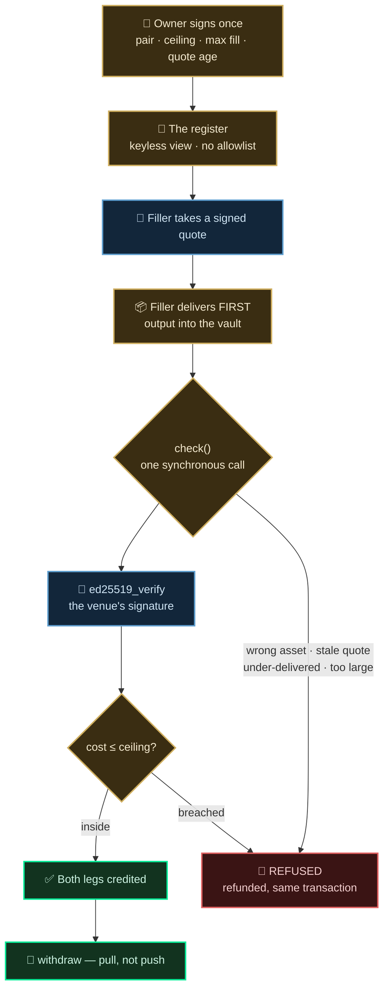
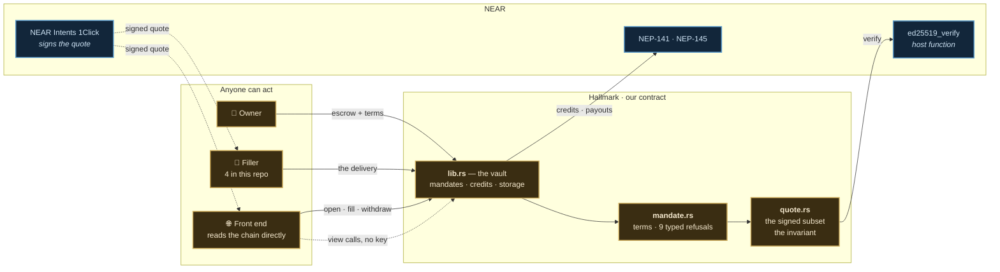

<div align="center">

# 🔖 Hallmark

### Oracle-free execution bounds for AI agents, on NEAR.

**An agent can be told who to pay and how much to spend — never what price is too bad.**
Hallmark closes that gap. An owner signs one agreement naming the worst all-in cost they
will accept. Anyone may fill it, but the filler delivers first, and the contract prices
that delivery against the dollar marks **NEAR Intents signed itself** — so there is no
price feed to manipulate and no fee list to keep current. Over the ceiling, it refuses
and refunds in the same transaction.

[](#testing)
[](https://nearblocks.io/address/hallmarkfi.near)
[](#the-one-invariant)
[](LICENSE)

🌐 [Live app](https://hallmarkfi.vercel.app) · 📖 [The register](https://hallmarkfi.vercel.app/book) · 📄 [Architecture](ARCHITECTURE.md) · ✅ [Verify on-chain](#build-and-run)

</div>

## The problem

Every guard you can put on an agent's money bounds the same three things: **who** it may
pay, **how much**, and **how often**.

**None of them is the price.** An agent swapping through a venue signs an
`ft_transfer_call` of the asset it is *spending*. `amountOut`, `minAmountOut` and the fees
live in the **quote** — off-chain, and not an argument to that call. A guard reading the
transaction is reading the wrong object.

**On 31 October 2026, NEAR Intents signed a quote offering $10 → 2.1437 wNEAR.** The
amount it *guarantees* is **0.00021437 wNEAR** — one ten-thousandth. Both numbers are in
the same signed payload, both are true, and the venue really signed it. It is
[`fixtures/worst.quote.json`](fixtures/worst.quote.json), and `npm run policy` runs a
textbook spend policy against it: **APPROVED**.

**Handing the guard the quote does not save it either.** Take the *honest* capture, where
nobody is attacking. It declares one percent of slippage, inside the signature, so a guard
may trust it completely:

```
honest.quote.json   declared slippage  100 bps  →  worst_cost   160 bps
worst.quote.json    declared slippage 9999 bps  →  worst_cost 10000 bps
```

Sixty percent more than the user asked for, because the solver's spread, the app fee and
the withdraw fee all sit outside slippage. **Reading a field is not the same as bounding
what you get.**

Handing someone discretion over the time and price of your trade is a century old — it is
called a **not-held order**, and the only thing that ever bounded it was a promise to try
hard, enforced after the fact by a regulator. NEAR Intents signs the economics of every
fill. So on NEAR that promise can be a number instead.

## What Hallmark is

Hallmark is a vault that enforces a not-held order's bound **before** it pays.

You escrow an asset and name a ceiling. Anyone may fill it — people or agents, no
allowlist, no registration. The filler delivers the output into the vault *first*; the
contract prices what arrived against the venue's own signature, and either credits both
legs or refuses and hands the delivery straight back. **One signature from you, ever.**

Three things make that safe to do without trusting anybody:

- The ceiling is **all-in**, computed from four fields the venue signed — not read from a
  slippage field, and never from an oracle.
- The filler **delivers first**, so the vault never sends to an address a counterparty
  nominated — the hole that cost NEAR Intents ~$3.8M on 1 October 2026.
- A refusal is **free and atomic**. The delivery is refunded in the same transaction, so
  the bound can be demonstrated on mainnet instead of argued for in a test.

> 🔓 **Try it — [hallmarkfi.vercel.app](https://hallmarkfi.vercel.app).** No login, no
> backend. Every figure is a keyless view call, so you can read the register, price any
> quote and see the contract's ruling without connecting a wallet at all.

## The one invariant

```
cost = 1 − (amountOutUsd × delivered / amountOut) / amountInUsd
```

Four fields the venue signed, and the amount that actually arrived. Slippage, bridge fee,
solver spread and any app fee have **already moved those numbers before the venue signed
them**, so there is nothing left to enumerate — which is why there is no fee list and no
oracle. The whole bound is 80 lines of [`contract/src/quote.rs`](contract/src/quote.rs),
and it fails closed for free: a quote that cannot be priced cannot be filled.

## How it works

One agreement, from the owner's signature to a filler getting paid. **Amber is our code,
blue is NEAR Intents**, green is an ending and red is a refusal.



- **Delivers first** — the output is in the vault before anything is credited, so nobody
  ever holds a counterparty's funds.
- **One call, no promise chain** — `ft_on_transfer` *is* the verification. Nothing can
  fail halfway, so there is no rollback path and no stuck state.
- **A refusal is one of nine typed reasons**, and the token's own panic-catch is what
  makes the refund free.
- **Pull, not push** — both sides call `withdraw`, so an unregistered counterparty cannot
  brick a fill.
- **The filler's pay is the spread**, so there is no fee field — and that spread is
  already inside the ceiling, because the ceiling prices what arrived.

## The trust ladder

Bounding an agent's spending normally asks you to trust five things. Each rung removes one.

| You'd normally trust | Hallmark | How |
|---|---|---|
| 🔮 **A price oracle** | There is none. Both USD marks are inside the venue's signature | `ed25519_verify`, on-chain |
| 🤖 **The agent's restraint** | The ceiling is in a contract the agent cannot reach | `max_cost_bps` |
| 🏦 **A custodian holding both legs** | The filler delivers first; the vault pays no address a counterparty named | §2.4 |
| 📜 **The venue's declared slippage** | Read it and you are still 60 bps short. The bound is computed | `worst_cost` |
| 🔑 **An admin who can pause or seize** | No pause, no seize. Withdraw any time | §10.2 |

## NEAR, used end-to-end

Take any one of these away and the design stops working.

| Capability | What Hallmark does with it | Live |
|---|---|---|
| **NEAR Intents** — the signed quote | The only thing taken from the venue. `amountIn`, `amountOut`, `minAmountOut` and **both USD marks** are signed, so the ceiling checks numbers the venue committed to | [`fixtures/`](fixtures/) |
| **`ed25519_verify`** host function | The signature is verified *on-chain* over the canonical bytes, against a hardcoded key — never trusted from a client | [`quote.rs`](contract/src/quote.rs) |
| **NEP-141** `ft_on_transfer` | The delivery *is* the call. One entry point, no promise chain, and the token's panic-catch makes a refusal refund for free | [`lib.rs`](contract/src/lib.rs) |
| **NEP-145** storage | Whoever writes a byte pays for it. A filler pays for the credit slots its fill creates; `withdraw` releases them | §2.11 |
| **Keyless view calls** | The entire proof surface — 13 view methods, so every guarantee is exercisable with no key and no funds | [`/verify`](https://hallmarkfi.vercel.app/verify) |
| **1Click cross-chain settlement** | A filler's balance sheet can live anywhere. Sourced on Base, delivered on NEAR, in both directions | §3.17 |

**Where NEAR Intents fits, and where it does not.** Hallmark uses exactly one thing: the
signature over a quote. It never uses Intents holding, routing or releasing a balance.
`depositAddress` sits *outside* the signature, and that is the same class of fault that
drained the Omni deposit layer — **Hallmark depends on the part that held, not the part
that did not.** Both legs settle on NEAR; where a chain gets crossed is the filler's own
side of the trade.

## Proven on NEAR mainnet

Read back off the chain on **8 November 2026**. [See the register
yourself](https://hallmarkfi.vercel.app/book) — no key, no account.

| | |
|---|---|
| Agreements opened | **6** |
| Fills settled | **5** — at 0, 23, 74, 97 and 141 bps |
| Fills that breached their ceiling | **0** |
| Refusals, refunded in the same transaction | **3** — two different reasons |
| Chains a filler sourced inventory from | **2** — NEAR and Base |
| Oracles consulted | **0** |

```bash
# count them yourself — no key, no account, no clone
curl -s -X POST https://rpc.mainnet.near.org -H 'Content-Type: application/json' \
  -d '{"jsonrpc":"2.0","id":1,"method":"query","params":{"request_type":"call_function",
       "finality":"final","account_id":"hallmarkfi.near","method_name":"get_mandates",
       "args_base64":"eyJmcm9tX2luZGV4IjowLCJsaW1pdCI6NTB9"}}' \
 | python3 -c 'import json,sys
d=json.loads(bytes(json.load(sys.stdin)["result"]["result"]).decode())
print(sum(m["fills"] for _,m in d), "fills across", len(d), "agreements")
print("worst-taken bps:", [m["worst_bps"] for _,m in d if m["fills"]])
print("any ceiling breached?", any(m["worst_bps"] > m["terms"]["max_cost_bps"] for _,m in d))'
```

### Agreement §6 — the whole thesis, in three transactions

One agreement. Three different accounts. All on mainnet.

| | account | transaction | outcome |
|---|---|---|---|
| **opened** | [`strongflour3266.near`](https://nearblocks.io/address/strongflour3266.near) | [`BmYJ8Cw…`](https://nearblocks.io/txns/BmYJ8CwRPLeeEcducg2QFnewNB14A3XXHLL4DNmRgJvy) | 0.01 USDT → wNEAR, **ceiling 300 bps** |
| **attacked** | [`d3bc15…7bd484`](https://nearblocks.io/address/d3bc151ad71667a0d3ee538c285ae8d72070b77aef6989e000bd44f05b7bd484) — a filler running its own code | [`5hixyWk…`](https://nearblocks.io/txns/5hixyWk52sTrogFJtBHtCsdUgBZycHZTEKWNMWSKdpXN) | **`REFUSED CostCeilingBreached { worst_bps: 527, ceiling_bps: 300 }`** — refunded |
| **filled** | [`sourlibrary2515.near`](https://nearblocks.io/address/sourlibrary2515.near) | [`DuwtArV…`](https://nearblocks.io/txns/DuwtArVBXPWzdCZwcjbH1z9apB3SWxs6LifFMGi9rVeZ) | **23 bps** against 300 |

```
EVENT_JSON:{"standard":"hallmark","version":"1.0.0","event":"filled",
  "data":[{"mandate_id":"6","filler":"sourlibrary2515.near",
           "amount_in":"10000","delivered":"2731566914714971209212",
           "cost_bps":23,"ceiling_bps":300}]}
```

**The attacker was not doing anything strange.** It asked the venue for an ordinary quote
with `slippageTolerance: 500` and delivered exactly the floor that quote guaranteed. Right
assets, right recipient, inside `max_fill`, quote one second old. **Every check passed but
the ceiling.** Nothing in the request is out of policy — the only thing wrong with it is
the loss it authorises, and that number appears in no field a policy engine reads.

**Read the refusal carefully: its outer status is `SuccessValue`.** `ft_transfer_call`
succeeds even when the receiver panics, because NEP-141 catches the panic in order to
refund. That is *why* a refused fill is free — and it means anything judging a fill by the
transaction's status reports this refused fill as filled. The refusal is in receipt 1 of 6,
and so is the refund.

### The rest of the evidence

| claim | settled by |
|---|---|
| A filler holding **zero** wNEAR drew up and served an agreement end to end | §3 at **141 bps**, sourced on Base with `EXACT_OUTPUT` — [`6A5Enuy…`](https://nearblocks.io/txns/6A5EnuyfTeiNezWvYLsvhi2pPYryEjXGHiU3tuiEjgeF) |
| A fill served out of Base inventory, in the other direction | §1 at **97 bps** — [`4AgkUn5…`](https://nearblocks.io/txns/4AgkUn5WfhBu5YVi37BMrzG4MzW1Czna3JzmeCYEe7be) |
| A signed quote, inside its own deadline, is still refused for being stale | [`3JKAnmb…`](https://nearblocks.io/txns/3JKAnmbAnQKM141iT3fd4Pk2jhTLjBmmYC3Gk4vp6Zyc) — `QuoteTooOld`, 326 s against a 300 s bound |
| A second ceiling refusal, at a different size | [`Fjz5cqJ…`](https://nearblocks.io/txns/Fjz5cqJfiWyhYAhAqekVPfp6nGpgrNAM51Y2XnRsn3vx) — 532 against 300 |
| Storage round-trips to the byte; the vault never subsidises | 426 → 123 → 426 prepaid bytes across open, fill and withdraw |
| Three independently-written fillers agree on the arithmetic | `npm run agree` — **39 comparisons, 0 disagreements, 0 bps gap** |

### Live on mainnet

| | |
|---|---|
| The vault | [`hallmarkfi.near`](https://nearblocks.io/address/hallmarkfi.near) |
| Code hash | `8q1qZFpXnnh3biMBHdgLzAjNQY3Y3pvNrCiQ1kLaJkLW` |
| The venue's signing key | `ed25519:reYaWhvwu8Jzo3WUM3zhn6VrhuMEF4eADL17qtRVifc` — ask it yourself: `quote_signer()` |
| Front end | [hallmarkfi.vercel.app](https://hallmarkfi.vercel.app) — static, no backend, no indexer |

## Architecture



Only the contract holds funds or decides anything. The client and the site are
conveniences — **a filler is not obliged to run our code**, and the one that doesn't ships
in this repo as `npm run breach`, so the bound can be shown to hold without them.

The canonicaliser exists three times on purpose — Rust, TypeScript and Python — and a test
asserts all three agree byte for byte and hash for hash.

## User flows

### The owner

```
1. storage_deposit()                 once, ~0.01 NEAR, reusable and refundable
2. choose a pair, a ceiling, a max fill, a max quote age, an expiry
3. ft_transfer_call the ORIGIN asset into the vault, msg = the mandate terms
4. walk away
5. withdraw() as fills arrive;  cancel(id) to recover unspent escrow
```

After step 3 the owner never signs again. The ceiling is enforced whether or not they are
watching, and whether or not their own agent is honest.

### The filler — nobody grants you permission

```
1. get_mandates()                    a keyless view call, no registration
2. POST /v0/quote                    recipient = the mandate's recipient
3. source the output                 inventory, 1Click, or anywhere else
4. ft_transfer_call the DESTINATION asset in
   msg = { mandate_id, canonical, signature }
5. withdraw(origin)
```

Step 4 succeeds completely or refuses completely. There is no partial state and nothing to
unwind.

## Build and run

Needs **Rust** (the toolchain is pinned in `rust-toolchain.toml`) and **Node 20+**.
Nothing else — no key, no funds, no wallet, no API token.

```bash
git clone https://github.com/Madhav-Gupta-28/Hallmark && cd Hallmark

cargo test                       # 60 tests — 32 unit, 28 against a real sandbox node
npm --prefix client   install && npm --prefix client test     # 54 assertions
npm --prefix frontend install && npm --prefix frontend test   # 99 tests
npm --prefix frontend run dev    # the site, on localhost:5173
```

**See:** 60 tests pass — 32 unit, 28 against a real sandbox node. The integration suite
stands up `wrap.near`, `eth.bridge.near` and the vault in a local node and fills a mandate
with a genuine NEAR Intents signature. Nothing is mocked.

Then the one that checks this README against reality:

```bash
./verify.sh --fast               # ~30s   everything above, minus the sandbox suite
./verify.sh                      # ~3min  all of it
```

It re-derives every number here and on the site, then asks the **live mainnet contract,
anonymously**, whether the claims hold. Non-zero exit if anything disagrees.

```
PASS  NEAR Intents really signed the 99.99%-loss quote (is_signed = true)
PASS  and the contract prices its floor at 10000 bps — a total loss
PASS  an honest quote declares 100 bps of slippage and still guarantees 160
PASS  an overflowing magnitude panics rather than pricing a fill at zero (§8.4)
PASS  mainnet refused a real fill the owner's ceiling did not allow (532 > 300 bps)
PASS  the register answers with no key: 6 agreement(s) in force

13 passed, 0 failed, 1 skipped
```

<details>
<summary><b>See the differentiator run, rather than asserted</b> — no key, no funds</summary>

```bash
cd client && npm install

npm run policy      # a textbook spend policy — allowlist, per-tx cap, daily cap,
                    # method list — run against both captures. APPROVED twice.
npm run bound -- USDC NEAR 100
                    # a freshly signed quote, and the bound the contract would enforce
npm run race        # three independently-written fillers price one live quote
npm run breach      # the filler that does NOT run our guard. The chain refuses it.
```
</details>

<details>
<summary><b>Ask the live contract yourself</b> — no key, no clone</summary>

```bash
near contract call-function as-read-only hallmarkfi.near get_mandates \
  json-args '{}' network-config mainnet now

near contract call-function as-read-only hallmarkfi.near quote_signer \
  json-args '{}' network-config mainnet now
```

Or open [`/verify`](https://hallmarkfi.vercel.app/verify) and paste any quote into it.
</details>

<details>
<summary><b>Build the deployable wasm, or deploy your own vault</b></summary>

```bash
./build.sh          # compiles with rustc 1.86 — nearcore's VM rejects anything newer
```

Deploying needs ~2.5 NEAR for the storage lock. Every step, every cost and the
irreversible one are in [DEPLOY.md](DEPLOY.md).
</details>

## What it costs to run

Measured on mainnet, not estimated.

| | |
|---|---|
| a whole fill | **8.25–30.48 TGas** burnt, depending on the token pair — against a 300 TGas limit |
| opening an agreement | the measured cost of its record, ~0.003 NEAR, returned by `cancel` |
| filling one | the measured cost of the credit slots it creates, charged to the filler |
| a refused fill | **gas only** — the delivery is refunded in the same transaction |
| the contract | 274,286 bytes of wasm; 278,941 bytes of account storage, staked at **2.79 NEAR** |

## Tech stack

- **Contract** — Rust · `near-sdk` **=5.24.1** (pinned: nearcore's VM rejects wasm from
  anything newer) · `bs58` · `serde`
- **NEAR** — NEP-141 · NEP-145 · `ed25519_verify` host function · keyless view calls ·
  NEAR Intents 1Click API
- **Client** — TypeScript · `near-api-js` · `@near-js/crypto` · `json-stable-stringify`
  (the canonical form 1Click's own SDK relies on) · `viem` (only to move a filler's
  inventory on Base)
- **Front end** — React 19 · Vite · `react-router-dom` · `@tanstack/react-query` ·
  `@near-wallet-selector/core` with Meteor and HERE · Tailwind 4 · static build, no
  backend, no database, no indexer
- **Quality** — 213 tests · `verify.sh` re-derives every claim against mainnet ·
  `check.py` re-derives every claim the site makes against source and chain

## Testing

| Suite | Tests | Covers |
|---|---|---|
| [`contract/src/tests.rs`](contract/src/tests.rs) | **32** | Every guarantee the spec claims — the invariant, each typed refusal, rounding direction, 256-bit intermediates, the overflow of §8.4, the deadline parser, **every byte of the signature** |
| [`contract/tests/`](contract/tests/) | **28** | End to end against a real sandbox node, with a genuine NEAR Intents signature. Nothing mocked |
| [`client/src/lib/canonical.test.ts`](client/src/lib/canonical.test.ts) | **54** | Canonicalisation, the quote hash, fixed-point parsing, the arithmetic against the fixtures |
| `frontend/` (vitest) | **99** | Transaction builders, redirect decoding, amount parsing, the three canonicalisers agreeing byte for byte |
| **Total** | **213** | Plus `verify.sh` — 14 checks, 6 against live mainnet — and `check.py`, 22 claims |

## Security notes

- **The refusal path cannot leak funds.** `ft_on_transfer` panics, NEP-141 catches it, and
  the delivery returns in the same transaction. Balances before and after are identical —
  demonstrated on mainnet three times.
- **No promise chain in the critical path.** One synchronous call that mutates only its own
  state. Nothing can fail halfway.
- **Pull, not push.** An unregistered counterparty cannot brick a fill.
- **A signature is not enough.** The quote's `deadline` is chosen by whoever *asked* for
  it, and 1Click signs one ten years out for free — so a filler could bank signed quotes
  as free options on the owner's escrow. `max_quote_age_secs` bounds the signed
  `timestamp` instead. **This was live on mainnet in v1 and is the worst defect the project
  ever had.**
- **The vault never pays for state a stranger creates** — which closed a ~10× leverage
  griefing hole (§2.11).
- **Rounding has exactly one safe direction**, and the reported cost is never below the
  true cost. The overflow that once broke that is recorded in §8.4.

## Repository layout

```
contract/src/quote.rs       the signed quote, the signature, the invariant
contract/src/mandate.rs     the terms, the nine typed refusals, check()
contract/src/lib.rs         the vault — 23 methods, 13 keyless views
contract/src/tests.rs       32 unit tests
contract/tests/integration.rs 28 tests, end to end against a real node
client/src/lib/canonical.ts canonicalisation — the one place it exists
client/src/bin/bound.ts     what a live quote actually guarantees
client/src/bin/breach.ts    the filler that does NOT run our guard
client/src/bin/policy.ts    a spend-policy guard, written out and run
client/src/fillers/         three competing fillers + the race harness
frontend/src/pages/         the site — 9 pages
frontend/tools/check.py     re-verifies the app's claims against source + chain
fixtures/                   signed captures + the canonicalisation script
verify.sh                   every claim in this README, in one command
```

[ARCHITECTURE.md](ARCHITECTURE.md) — the full spec, every claim with a reproduction
command. [DEPLOY.md](DEPLOY.md) — every deployment step and what it costs.

## What it does not do

Stated plainly, because a build that hides its edges is not worth trusting.
[`/limits`](https://hallmarkfi.vercel.app/limits) says the same on the site, and §14 of
ARCHITECTURE.md numbers every one.

- **A compromised 1Click signing key breaks every bound here.** It is the trust anchor and
  this is unmitigated.
- **A bound is not best execution.** Hallmark proves a fill was inside the ceiling you set,
  not that it was the best fill available — there is no independent price benchmark on
  NEAR to prove that against.
- **Liveness depends on 1Click.** If the API stops signing, no new fill can be priced.
  Escrow is never stuck: `cancel` needs nothing from the venue.
- **The filler needs capital.** Delivering first means holding inventory or carrying price
  risk while sourcing it — the deliberate cost of never paying an address a counterparty
  named.
- **Four fillers, all written or adapted by us.** There is no third-party filler ecosystem
  and none is claimed.
- **Mainnet only.** No NEAR Intents testnet exists or is planned.
- **The contract is still upgradeable.** §10.2 argues why that key is deleted *last*: an
  audit found a critical bug in a contract that was already live, and a contract with no
  key could not have been fixed.

## Roadmap

- **Delete the full-access key**, making the vault immutable.
- **A third-party filler.** The supply side is the honest gap; joining needs no permission.
- **More venues.** The invariant needs a venue that signs the economics of a fill. NEAR
  Intents is the only one today; any other that does would work unchanged.
- **Mainnet at size**, after a professional audit.

## The other submission

> *Hackathon rule Q-015: one person may enter up to two projects if they are independent
> and each README names the other.*

**Hallmark** is led by **Madhav Gupta** and is the project submitted here. **Docket** is a
separate project led by **Aditi**, who also contributed the frontend work on Hallmark. The
two are independent: different problems, different contracts, no shared code, and neither
depends on the other.

> Docket's repository: *to be added before submission.*

## Libraries, and what was already here

> *Hackathon rules Q-005 (list every library and template) and Q-002/Q-004 (disclose
> anything pre-existing).*

**Baseline: none.** Hallmark was started on 2026-11-01, inside the window, and every commit
here is hackathon work. No earlier product, no ported contract, no pre-hackathon library of
ours in the tree.

**No starter template.** `frontend/` began as `npm create vite` and everything in `src/`
was written for this project. The shadcn dialog and button primitives are the upstream
generated components, trimmed to what this app renders.

**Not ours, and not vendored:** the signed quotes in `fixtures/` are genuine NEAR Intents
API responses, committed verbatim so the signature still verifies.
`client/src/fillers/adapted.ts` is NEAR's own
[agent-skills](https://github.com/near/agent-skills) `rules/server-example.md` with four
marked changes — which is the point of that file.

Full dependency list in [Tech stack](#tech-stack) and in each `package.json` / `Cargo.toml`.

## AI tooling

Built with AI assistance (Anthropic's Claude, via Claude Code) for code, tests and prose,
under line-by-line human review. Everything it produced was checked by running it: the
contract is deployed on mainnet, the 60 Rust tests and 54 client assertions run from a
clean clone, and `check.py` re-verifies the app's claims against the source and the live
chain rather than against anybody's recollection.

The two vulnerabilities in §2.10 and §2.11 were found by auditing a version that was
**already live**, and both were found by *measuring* — printing real `storage_usage`
deltas, replaying a genuinely signed three-day-old quote against the deployed contract —
not by reasoning about the code. Three wrong fixes are recorded in ARCHITECTURE.md
alongside the right one, for the same reason.

## Licence

MIT — see [LICENSE](LICENSE).

---

<div align="center">

🌐 [Live app](https://hallmarkfi.vercel.app) · 📖 [The register](https://hallmarkfi.vercel.app/book) · 📄 [Architecture](ARCHITECTURE.md) · ⚖️ [What this is not](https://hallmarkfi.vercel.app/limits)

</div>
