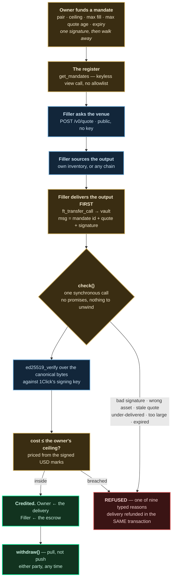
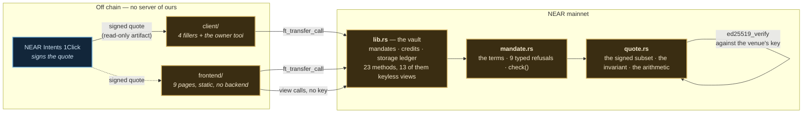

<picture>
  <source media="(prefers-color-scheme: dark)" srcset="frontend/public/logo-paper.svg">
  
</picture>

# 🔖 Hallmark

**Price bounds for AI agents, on NEAR. No oracle.**

You can already tell an agent *who* it may pay and *how much* it may spend. You
cannot tell it what price is too bad. Hallmark lets you: an owner signs one
agreement naming the worst all-in cost they will accept, and the contract
refuses any fill that breaches it — checked against the dollar marks **NEAR
Intents signed itself**, so there is no price feed to manipulate and no fee
list to keep current.

[](#testing)
[](https://nearblocks.io/address/hallmarkfi.near)
[](#the-one-invariant)
[](LICENSE)

🌐 **[Live app](https://hallmarkfi.vercel.app)** · 📄 [Architecture](ARCHITECTURE.md) · ✅ [Verify on-chain](#verify-every-word-of-this) · 🔍 [The register, live](https://hallmarkfi.vercel.app/book)

**6 agreements on NEAR mainnet · 5 fills at 0, 23, 74, 97 and 141 bps — every one inside its ceiling · 3 refusals, every delivery refunded in the same transaction · 0 oracles**

---

## The problem

On 31 October 2026, NEAR Intents signed a quote offering **$10 → 2.1437
wNEAR**. The amount that quote *guarantees* is **0.00021437 wNEAR** — one
ten-thousandth of it. Both numbers sit in the same signed payload. Both are
true. The venue really signed it. The capture is
[`fixtures/worst.quote.json`](fixtures/worst.quote.json).

**No spend policy catches it.** The standard way to make an agent safe with
money bounds *who* it may pay, *how much*, and *how often* — never what the
money is worth when it arrives. That is not carelessness. An agent swapping
through a venue signs an `ft_transfer_call` of the asset it is *spending*;
`amountOut`, `minAmountOut` and the fees are fields of the **quote**, which is
off-chain and is not an argument to that call. A guard reading the transaction
is reading the wrong object.

**And handing the guard the quote does not save it either.** Take the *honest*
capture, where nothing is hidden and nobody is attacking. It declares
`slippageTolerance: 100` — one percent — and that field is **inside the
signature**, so a guard may trust it completely. Ask the live contract what the
same bytes actually guarantee:

```
honest.quote.json   declared slippage  100 bps  →  worst_cost   160 bps
worst.quote.json    declared slippage 9999 bps  →  worst_cost 10000 bps
```

Sixty percent more than the number the user set, because slippage is not the
all-in cost — the solver's spread, the app fee and the withdraw fee all sit
outside it. The second line is the honest half: the malicious capture's
slippage field is at its maximum, so a slippage check *would* catch that one.
The point is not that the field is unreadable. **It is that reading it is not
the same as bounding what you get.**

Handing someone discretion over the time and price of your trade is a century
old — it is called a *not-held order*, and the only thing that ever bounded it
was a promise to try hard, enforced after the fact by a regulator. NEAR Intents
signs the economics of every fill. So on NEAR that promise can be a number
instead.

## What Hallmark is

A vault that holds an owner's escrow against terms they signed once, and pays a
filler only for a delivery that satisfies them.

- **An owner funds a mandate** — a pair, a worst acceptable all-in cost, a
  maximum fill, a maximum quote age, an expiry. One signature, then they walk
  away.
- **Anyone may fill it.** No allowlist, no registration, no permission. The
  register is a keyless view call and the contract never asks who you are.
- **The filler delivers first.** The output is in the vault before anything is
  credited, so the vault never sends to an address a counterparty nominated —
  which is exactly the hole that cost NEAR Intents ~$3.8M on 1 October 2026.
- **The bound is checked against the venue's own signature**, not against a
  price feed, not against anything the filler says.
- **A refusal is free.** The delivery is refunded in the same transaction. A
  refused filler loses gas and nothing else.

No oracle. No price feed. No keeper. No cron. No indexer. No server. No
custodian.

🔓 **Try it — [hallmarkfi.vercel.app](https://hallmarkfi.vercel.app).** No login,
no backend. Every number on every page is a keyless view call to
`hallmarkfi.near`; you can read the whole register, price any quote and see the
contract's ruling without connecting a wallet at all.

## The one invariant

```
cost = 1 − (amountOutUsd × delivered / amountOut) / amountInUsd
```

Four fields the venue signed, and the amount that actually arrived. Slippage,
bridge fee, solver spread and any app fee have all already moved those numbers
*before* the venue signed them, so there is nothing else to enumerate — which
is why there is no fee list and no oracle. The whole bound is 80 lines in
[`contract/src/quote.rs`](contract/src/quote.rs).

It is computable from a signed quote alone, so it **fails closed for free**: a
quote that cannot be priced cannot be filled.

## How it works

One agreement, from the owner's signature to a filler getting paid. Amber is
our code, blue is NEAR Intents, green is an ending and red is a refusal.



**The filler delivers first, and that is the load-bearing decision.** It is why
there is no promise chain in the critical path: `ft_on_transfer` is the entire
verification, it is synchronous, and it mutates only its own state. There is no
cross-contract call to fail halfway, so there is no rollback path, no in-flight
record and no stuck state. Payouts are *pull, not push*, so a counterparty who
is not storage-registered on a token cannot brick a fill.

**The filler's pay is the spread**, so there is no fee field. You keep the gap
between what you sourced the output for and what you delivered — and that gap
is already inside the owner's ceiling, because the ceiling prices what arrived.

## The trust ladder

Bounding an agent's spending normally asks you to trust five things. Each rung
removes one.

| You'd normally trust | Hallmark | How |
|---|---|---|
| 🔮 **A price oracle** | There is none. Both USD marks are inside the venue's signature | `amountInUsd` / `amountOutUsd`, verified by `ed25519_verify` |
| 🤖 **The agent's own restraint** | The ceiling is in a contract the agent cannot reach, not in its prompt or its code | `max_cost_bps`, checked before anything is credited |
| 🏦 **A custodian holding both legs** | The filler delivers first; the vault never pays an address a counterparty named | §2.4 — the hole that cost Intents $3.8M |
| 📜 **The venue's declared slippage** | Read it and you are still 60 bps short. The bound is computed, not read | `worst_cost` vs `slippageTolerance` |
| 🔑 **An admin who can pause or seize** | No pause, no seize, no upgrade path once the key is deleted. Withdraw any time | §10.2 |

## Proven on NEAR mainnet

Read back off the chain on **8 November 2026**. [See the register
yourself](https://hallmarkfi.vercel.app/book) — no key, no account.

| | |
|---|---|
| Agreements opened | **6** |
| Fills settled | **5** — at 0, 23, 74, 97 and 141 bps |
| Fills that breached their ceiling | **0** |
| Refusals, delivery refunded in the same transaction | **3** — two reasons |
| Chains a filler sourced inventory from | **2** — NEAR and Base |
| Oracles consulted | **0** |

```bash
# count them yourself — no key, no account, no clone
curl -s -X POST https://rpc.mainnet.near.org -H 'Content-Type: application/json' \
  -d '{"jsonrpc":"2.0","id":1,"method":"query","params":{"request_type":"call_function",
       "finality":"final","account_id":"hallmarkfi.near","method_name":"get_mandates",
       "args_base64":"eyJmcm9tX2luZGV4IjowLCJsaW1pdCI6NTB9"}}' \
 | python3 -c 'import json,sys
d=json.loads(bytes(json.load(sys.stdin)["result"]["result"]).decode())
print(sum(m["fills"] for _,m in d), "fills across", len(d), "agreements")
print("worst-taken bps:", [m["worst_bps"] for _,m in d if m["fills"]])
print("any ceiling breached?", any(m["worst_bps"] > m["terms"]["max_cost_bps"] for _,m in d))'
```

### Agreement §6 — the whole thesis, in three transactions

One agreement, three different accounts, all on mainnet.

| | account | transaction | outcome |
|---|---|---|---|
| **opened** | `strongflour3266.near` | [`BmYJ8Cw…`](https://nearblocks.io/txns/BmYJ8CwRPLeeEcducg2QFnewNB14A3XXHLL4DNmRgJvy) | 0.01 USDT → wNEAR, **ceiling 300 bps**, 300 s quote age |
| **attacked** | a filler running its own code | [`5hixyWk…`](https://nearblocks.io/txns/5hixyWk52sTrogFJtBHtCsdUgBZycHZTEKWNMWSKdpXN) | **`REFUSED CostCeilingBreached { worst_bps: 527, ceiling_bps: 300 }`** — refunded |
| **filled** | `sourlibrary2515.near` | [`DuwtArV…`](https://nearblocks.io/txns/DuwtArVBXPWzdCZwcjbH1z9apB3SWxs6LifFMGi9rVeZ) | **23 bps** against 300 |

```
EVENT_JSON:{"standard":"hallmark","version":"1.0.0","event":"filled",
  "data":[{"mandate_id":"6","filler":"sourlibrary2515.near",
           "amount_in":"10000","delivered":"2731566914714971209212",
           "cost_bps":23,"ceiling_bps":300}]}
```

**Read the refusal carefully, because its outer status is `SuccessValue`.**
`ft_transfer_call` succeeds even when the receiver panics — NEP-141 catches the
panic so it can refund the sender. That is *why* a refused fill is free, and it
means anything judging a fill by the transaction's status reports this refused
fill as filled. The refusal is in receipt 1 of 6, and so is the refund.

The attacking filler asked the venue for an ordinary quote with
`slippageTolerance: 500` — not an absurd setting, an ordinary one — and
delivered exactly the floor that quote guaranteed. Right assets, right
recipient, inside `max_fill`, quote one second old. **Every check passed but the
ceiling.** Nothing in the request is out of policy; the only thing wrong with it
is the loss it authorises, and that number appears in no field a policy engine
reads.

### The other evidence

| claim | settled by |
|---|---|
| A filler holding **zero** wNEAR drew up and served an agreement end to end | §3 at **141 bps**, sourced on Base with `EXACT_OUTPUT` — [`6A5Enuy…`](https://nearblocks.io/txns/6A5EnuyfTeiNezWvYLsvhi2pPYryEjXGHiU3tuiEjgeF) |
| A fill served out of Base inventory, in the other direction | §1 at **97 bps** — [`4AgkUn5…`](https://nearblocks.io/txns/4AgkUn5WfhBu5YVi37BMrzG4MzW1Czna3JzmeCYEe7be) |
| A stale quote is refused even though it is signed and inside its own deadline | [`3JKAnmb…`](https://nearblocks.io/txns/3JKAnmbAnQKM141iT3fd4Pk2jhTLjBmmYC3Gk4vp6Zyc) — `REFUSED QuoteTooOld`, 326 s against a 300 s bound |
| A second ceiling refusal, at a different size | [`Fjz5cqJ…`](https://nearblocks.io/txns/Fjz5cqJfiWyhYAhAqekVPfp6nGpgrNAM51Y2XnRsn3vx) — 532 against 300 |
| Storage round-trips to the byte; the vault never subsidises | 426 → 123 → 426 prepaid bytes across open, fill and withdraw |
| Three independent fillers agree on the arithmetic | `npm run agree` — **39 comparisons, 0 disagreements, 0 bps maximum gap** |

## NEAR, used end-to-end

Take any one of these away and the design stops working.

| Capability | What Hallmark does with it | Live |
|---|---|---|
| **NEAR Intents — the signed quote** | The only thing taken from the venue. `amountIn`, `amountOut`, `minAmountOut` and **both USD marks** are signed, so the ceiling is checked against numbers the venue committed to | [`fixtures/`](fixtures/) |
| **`ed25519_verify` host function** | The signature is verified *on-chain*, over the canonical bytes, against a hardcoded key. Not trusted from a client | [`quote.rs`](contract/src/quote.rs) |
| **NEP-141 `ft_on_transfer`** | The delivery *is* the call. One synchronous entry point, no promise chain, and the token's own panic-catch is what makes a refusal refund for free | [`lib.rs`](contract/src/lib.rs) |
| **NEP-145 storage** | Whoever writes a byte pays for it. A filler pays for the credit slots its fill creates, and `withdraw` releases them | §2.11 |
| **NEAR's keyless view calls** | The entire proof surface. 13 view methods, so every guarantee can be exercised with no key, no funds and no deposit | [`/verify`](https://hallmarkfi.vercel.app/verify) |
| **1Click cross-chain settlement** | A filler's balance sheet can live anywhere. Sourced on Base, delivered on NEAR, in both directions | §3.17 |

**Where NEAR Intents fits, and where it does not.** Hallmark uses exactly one
thing: the signature over a quote. It never uses Intents holding, routing or
releasing a balance for it. The vault sends nothing to any address a
counterparty nominated — `depositAddress` is outside the signature, and that is
the same class of fault that drained the Omni deposit layer. **Hallmark depends
on the part that held, not the part that did not.**

Both legs of a mandate settle on NEAR. Where a chain gets crossed is the
*fill*, and that is the filler's own side of the trade.

## Architecture



Only the contract holds funds or decides anything. The client and the site are
conveniences: **a filler is not obliged to run our code**, and the one that
doesn't is in the repository as `npm run breach`, so the bound can be shown to
hold without them.

The canonicaliser exists three times on purpose — Rust, TypeScript and Python —
and a test asserts all three agree byte for byte and hash for hash. Nothing
about the bound depends on one implementation being right.

## User flows

### The owner

```
0. storage_deposit(storage_cost_estimate())   # once, ~0.01 NEAR, reusable and refundable
1. choose a pair, a ceiling, a max fill, a max quote age, an expiry
2. ft_transfer_call the ORIGIN asset into the vault, msg = the mandate terms
3. walk away
4. withdraw(destination) as fills arrive;  cancel(id) to recover unspent escrow
```

After step 2 the owner never signs again. The ceiling is enforced whether or
not they are watching, and whether or not their agent is honest.

### The filler — nobody grants you permission

```
1. get_mandates()                       # a keyless view call
2. POST /v0/quote   recipient = <the mandate's recipient>
3. source the output (inventory, 1Click, or anywhere else)
4. ft_transfer_call the DESTINATION asset into the vault
   msg = { mandate_id, canonical, signature }
5. withdraw(origin)
```

Step 4 either succeeds completely or refuses completely. There is no partial
state and nothing to unwind.

### The judge

```bash
git clone … && cd hallmark && ./verify.sh --fast      # ~30s, no key, no funds, no wallet
```

It runs every test, re-derives every number this README and the site state, and
then asks the **live mainnet contract — anonymously** — whether NEAR Intents
really signed the 99.99%-loss quote, what it prices that quote's floor at,
whether a malformed magnitude is refused, and whether the ceiling really did
turn away a real fill. Non-zero exit if anything disagrees.

```
PASS  NEAR Intents really signed the 99.99%-loss quote (is_signed = true)
PASS  and the contract prices its floor at 10000 bps — a total loss
PASS  an honest quote declares 100 bps of slippage and still guarantees 160
PASS  an overflowing magnitude panics rather than pricing a fill at zero (§8.4)
PASS  mainnet refused a real fill the owner's ceiling did not allow (532 > 300 bps)
PASS  the register answers with no key: 6 agreement(s) in force
```

## Verify every word of this

Each one is `do this → see that`. Nothing needs a key or funds unless it says so.

| # | Command | What it proves |
|---|---|---|
| 1 | `cargo test` | 60 tests — 32 unit, 28 against a real sandbox node. Including `malicious_quote_is_a_9999_bps_haircut_and_is_validly_signed` and `every_single_byte_is_covered_by_the_signature` (all 692 bytes flipped one at a time, each rejected) |
| 2 | `near view hallmarkfi.near worst_cost '{…}'` | The live contract prices the malicious capture's floor at **10000 bps**. No key |
| 3 | `cd client && npm run bound -- USDC NEAR 100` | A freshly signed quote, and the bound the contract would enforce on it. No key, no funds |
| 4 | `cd frontend && npm install && npm run dev` | The site, on `localhost:5173` |
| 5 | `cd client && npm run policy` | A spend-policy guard — allowlist, per-tx cap, daily cap, method list — written out plainly and run against both captures. **APPROVED twice** |
| 6 | `cd client && npm run race` | Three independently-written fillers price one live quote, disagree about strategy, and land inside the same bound |
| 7 | `cd client && npm run breach` | The filler that does not run our guard. It gets refused by the chain |

Or run every suite at once:

```bash
cargo test                          # 60 tests
npm --prefix client test            # 54 assertions
npm --prefix frontend test          # 99 tests
./verify.sh --fast                  # all 13, re-derived against live mainnet, ~30s
```

**See:** 60 tests pass — 32 unit, 28 against a real sandbox node. No network, no
key, no funds.

## What it costs to run

Measured on mainnet, not estimated.

| | |
|---|---|
| a whole fill | **8.25–30.48 TGas** burnt, depending on the token pair — against a 300 TGas transaction limit |
| opening an agreement | the **measured** cost of its record, ~0.003 NEAR, returned by `cancel` |
| filling one | the measured cost of the two credit slots it creates, charged to the filler and released on `withdraw` |
| a refused fill | gas only. The delivery is refunded in the same transaction |
| the contract | 274,286 bytes of wasm; 278,941 bytes of account storage, which NEAR stakes **2.79 NEAR** against |

## Tech stack

- **Contract** — Rust, `near-sdk` 5.24.1 (pinned: nearcore's VM rejects wasm from
  anything newer), `bs58`, `serde`. 274,286 bytes of wasm, code hash
  `8q1qZFpXnnh3biMBHdgLzAjNQY3Y3pvNrCiQ1kLaJkLW`.
- **NEAR** — NEP-141 · NEP-145 · `ed25519_verify` host function · keyless view
  calls · NEAR Intents 1Click API.
- **Client** — TypeScript, `near-api-js`, `@near-js/crypto`,
  `json-stable-stringify` (the canonical form 1Click's own SDK relies on),
  `viem` (only to move a filler's inventory on Base).
- **Front end** — React 19, Vite, `react-router-dom`, `@tanstack/react-query`,
  `@near-wallet-selector/core` with the Meteor and HERE modules, Tailwind 4.
  Static build, no backend, no database, no indexer.
- **Quality** — 213 tests, `verify.sh` re-derives every claim against mainnet,
  `check.py` re-derives every claim the site makes against the source and the
  chain.

## Testing

| Suite | Tests | Covers |
|---|---|---|
| `contract/src/tests.rs` | **32** | Every guarantee the spec claims: the invariant, each typed refusal, rounding direction, 256-bit intermediates, the overflow of §8.4, the deadline parser, every byte of the signature |
| `contract/tests/integration.rs` | **28** | End to end against a real sandbox node — `wrap.near`, `eth.bridge.near` and the vault stood up for real, filled with a genuine NEAR Intents signature. Nothing is mocked |
| `client/src/lib/canonical.test.ts` | **54** | Canonicalisation, the quote hash, fixed-point parsing, the arithmetic against the fixtures |
| `frontend/` (vitest) | **99** | Transaction builders, redirect decoding, amount parsing, the three canonicalisers agreeing byte for byte |
| **Total** | **213** | Plus `verify.sh` — **14 checks, 13 of them without a sandbox node, 6 against live mainnet** — and `check.py` (22 claims re-derived from source and chain) |

## Security notes

- **The refusal path cannot leak funds.** `ft_on_transfer` panics on refusal,
  NEP-141 catches it, and the delivery returns to the filler in the same
  transaction. Balances before and after are identical — demonstrated on
  mainnet three times, not argued for in a test.
- **No promise chain in the critical path.** The whole verification is one
  synchronous call that mutates only its own state. Nothing can fail halfway.
- **Pull, not push.** Both parties call `withdraw`, so a counterparty who is
  not storage-registered on a token cannot brick a fill.
- **A signature is not enough.** The quote's `deadline` is chosen by whoever
  *asked* for the quote, and 1Click will sign one ten years out for free — so a
  filler could bank free signed quotes as options on the owner's escrow.
  `max_quote_age_secs` bounds the signed `timestamp` instead. **This was live on
  mainnet in v1 and is the most serious defect the project ever had.**
- **The vault never pays for state a stranger creates.** Storage is prepaid and
  charged to whoever writes the byte, which closed a ~10× leverage griefing
  hole (§2.11).
- **Rounding has exactly one safe direction**, and the reported cost is never
  below the true cost — asserted as an invariant, with the overflow that once
  broke it recorded in §8.4.
- **Every magnitude is checked.** A quotient that does not fit panics rather
  than pricing a fill at zero — found by a second audit of a version that was
  already live.

## Repository layout

```
contract/src/quote.rs       the signed quote, the signature, the invariant
contract/src/mandate.rs     the terms, the nine typed refusals, check()
contract/src/lib.rs         the vault — 23 methods, 13 keyless views
contract/src/tests.rs       32 unit tests
contract/tests/integration.rs 28 tests, end to end against a real node
client/src/lib/canonical.ts canonicalisation — the one place it exists
client/src/bin/bound.ts     what a live quote actually guarantees
client/src/bin/post.ts      the owner
client/src/bin/fill.ts      the reference filler
client/src/bin/breach.ts    the filler that does NOT run our guard
client/src/bin/policy.ts    a spend-policy guard, written out and run
client/src/fillers/         three competing fillers + the race harness
frontend/src/pages/         the site — 9 pages
frontend/tools/check.py     re-verifies the app's claims against source + chain
fixtures/                   signed captures + the canonicalisation script
verify.sh                   every claim in this README, in one command
ARCHITECTURE.md             the full specification
```

## What it does not do

Stated plainly, because a build that hides its edges is not worth trusting.
[`/limits`](https://hallmarkfi.vercel.app/limits) says the same thing on the
site, and §14 of [ARCHITECTURE.md](ARCHITECTURE.md) numbers every one.

- **A compromised 1Click signing key breaks every bound here.** It is the trust
  anchor, and this is unmitigated. We would rather you read it here than find
  it yourself.
- **A bound is not best execution.** Hallmark proves a fill was inside the
  ceiling you set. It does not prove it was the best fill available — there is
  no independent price benchmark on NEAR to prove that against (§3.12).
- **Liveness depends on 1Click.** If the API stops signing quotes, no new fill
  can be priced. Escrow is never stuck: `cancel` needs nothing from the venue.
- **The filler needs capital.** Delivering first means holding inventory or
  carrying price risk while sourcing it. That is the deliberate cost of never
  paying an address a counterparty named.
- **Four fillers, all written or adapted by us.** There is no third-party filler
  ecosystem and none is claimed.
- **Mainnet only.** No NEAR Intents testnet exists or is planned.
- **The contract is still upgradeable.** `hallmarkfi.near` holds a full-access
  key. §10.2 argues why that key is deleted *last* rather than first: an audit
  found a critical bug in a contract that was already live, and a contract with
  no key could not have been fixed.

## Roadmap

- **Delete the full-access key**, making the vault immutable.
- **A third-party filler.** The supply side is the honest gap; the mechanism
  needs no permission to join, which is the point.
- **More venues.** The invariant needs a venue that signs the economics of a
  fill. NEAR Intents is the only one today; any other that does would work
  unchanged.
- **A professional audit**, then removing the key.

## The other submission

> *Hackathon rule Q-015: one person may enter up to two projects if they are
> independent and each README names the other.*

**Hallmark** is led by **Madhav Gupta** and is the project submitted here.

**Docket** is a separate project led by **Aditi**, who also contributed the
frontend work on Hallmark. The two are independent: different problems,
different contracts, no shared code, and neither depends on the other.

> Docket's repository: *to be added before submission.*

## Libraries, and what was already here

> *Hackathon rules Q-005 (list every library and template) and Q-002/Q-004
> (disclose anything pre-existing).*

**Baseline: none.** Hallmark was started on 2026-11-01, inside the window, and
every commit in this repository is hackathon work. There is no earlier product,
no ported contract and no pre-hackathon library of ours in the tree.

**No starter template.** `frontend/` began as `npm create vite` and everything
in `src/` was written for this project. The shadcn dialog and button primitives
are the upstream generated components, trimmed to the parts this app renders.

**Not ours, and not vendored:** the signed quotes in `fixtures/` are genuine
NEAR Intents API responses, captured and committed verbatim so the signature
still verifies. `client/src/fillers/adapted.ts` is NEAR's own
[agent-skills](https://github.com/near/agent-skills)
`rules/server-example.md` with four marked changes, which is the point of that
file.

Full dependency list in [Tech stack](#tech-stack) above and in each
`package.json` / `Cargo.toml`.

## Licence

MIT — see [LICENSE](LICENSE).

## AI tooling

This project was built with AI assistance (Anthropic's Claude, via Claude Code)
for code, tests and prose, under line-by-line human review. Everything it
produced was checked by running it: the contract is deployed on NEAR mainnet,
the 60 Rust tests and 54 client assertions run from a clean clone, and
`frontend/tools/check.py` re-verifies the app's factual claims against the
source and the live chain rather than against anybody's recollection.

The two vulnerabilities in §2.10 and §2.11 were found by auditing a version that
was **already live**, and both were found by *measuring* — printing real
`storage_usage` deltas, replaying a genuinely signed three-day-old quote against
the deployed contract — not by reasoning about the code. Three wrong fixes are
recorded in ARCHITECTURE.md alongside the right one, for the same reason.

---

🌐 **[Live app](https://hallmarkfi.vercel.app)** · 📄 [Architecture](ARCHITECTURE.md) · 🔍 [The register](https://hallmarkfi.vercel.app/book) · ⚖️ [What this is not](https://hallmarkfi.vercel.app/limits)
